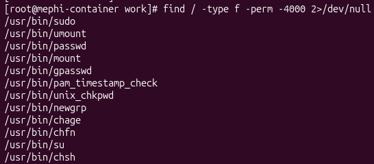
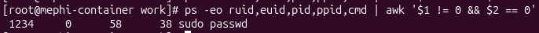

# 1

# 1.1

Создаем группу `groupadd students` 

и пользователя `useradd -m -u М265193 -g students -s /bin/bash user1`.

Часть команд выполнялась от имени пользователя после `su - user1` и поэтому находятся в [.bash_history](bash_history)

# 2

# 2.1

Находим все файлы с установленным битом set-UID `find / -type f -perm -4000 2>/dev/null`

# 2.2

Находим в системе все процессы, у которых эффективный UID равен 0, а реальный UID относится к обычным пользователям
`ps -eo ruid,euid,pid,ppid,cmd | awk '$1 != 0 && $2 == 0'`

Изначально таких не было, поэтому запускаем смену пароля для user1 и видим этот процесс

# 3

Вывод `cat /etc/passwd` и так был доступен, поэтому для проверки использовалась команда `cat /etc/shadow`, которая
изначально была недоступна. 
После `chown root:root /home/user1/cat` команда `cat /etc/shadow` заработала

# 4

Для проверки использовалась команда `chown root:root test.txt`, которая
изначально была недоступна.
После `setcap cap_chown+ep /home/user1/chown` команда `hown root:root test.txt` заработала

# 5

Была использована команда `visudo` и в открытом файле была добавлена строчка
`user1 ALL=(root) /usr/bin/date`
